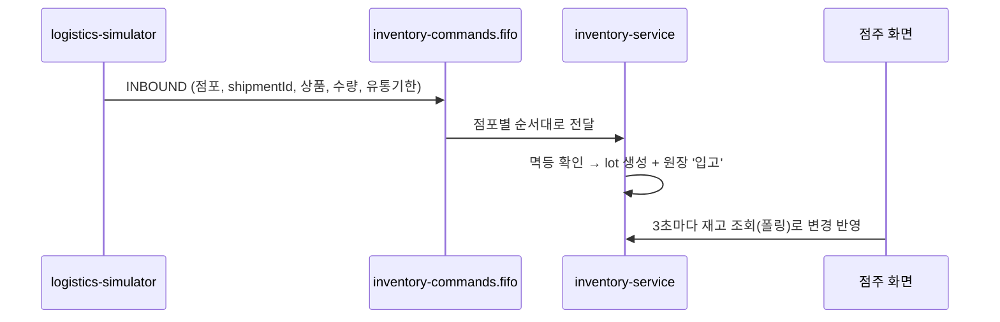

# logistics-simulator

> **가상의 물류센터**. 실제 물류 시스템 대신 점포별 입고 정보(INBOUND 쪽지)를 만들어 재고 큐에 넣는다. 시연할 때 버튼이나 API 한 번으로 점포 3곳에 상품을 들여보낸다.

| 항목 | 내용 |
| --- | --- |
| 담당 | 김진아 |
| 관련 기능 ID | E-13 logistics-simulator |
| 기술 | Java 21, Spring Boot 3, Spring Cloud AWS (SQS) |
| 관측성 | Actuator·Micrometer → Prometheus (`/actuator/prometheus`, 관리 포트 8081) · Micrometer Tracing → Zipkin · JSON 로그(traceId 포함) → Alloy → Loki ([gitops/platform/observability](https://github.com/sesac-freshlink/gitops/tree/main/platform/observability)) |
| DB | 없음 (더미 입고 데이터를 생성) |
| 배포 | GitHub Actions → ECR `freshlink/logistics-simulator` → ArgoCD → EKS (파드 1개, 시연 때 사용) |

---

## 1. FreshLink는 무엇인가

편의점 점주와 고객이 **같은 재고 데이터**를 보는 서비스다. 전체 소개는 [Organization README](https://github.com/sesac-freshlink)를 참고한다.

## 2. 아키텍처에서의 위치



> 예: 새벽 5시, 시뮬레이터가 역삼점에 컵라면 20개(유통기한 10월 20일)와 우유 10개(10월 9일) 입고 쪽지를 보낸다. 점주가 출근하면 재고 화면에 유통기한별로 들어와 있다.

## 3. INBOUND 쪽지 형식

큐: `inventory-commands.fifo` · 메시지 그룹 = `storeId` · 중복 제거 키 = `messageId`

```json
{
  "messageId": "6a0f...-uuid",
  "type": "INBOUND",
  "storeId": "S001",
  "shipmentId": "SHP-20261012-S001-01",
  "items": [
    { "productCode": "P-CUPNOODLE", "quantity": 20, "expiryDate": "2026-10-20" },
    { "productCode": "P-MILK",      "quantity": 10, "expiryDate": "2026-10-09" }
  ],
  "createdAt": "2026-10-12T05:00:00+09:00"
}
```

쪽지 DTO는 [common](https://github.com/sesac-freshlink/common) 모듈의 것을 그대로 쓴다. 같은 `shipmentId`는 inventory-service가 두 번 반영하지 않는다.

## 4. 폴더 구조

```
logistics-simulator/
├── src/main/java/com/freshlink/simulator/
│   ├── config/      # SQS 설정
│   ├── shipment/    # 더미 입고 데이터 생성, 실행 API
│   └── messaging/   # INBOUND 쪽지 발행
├── src/main/resources/application.yml
└── src/test/java/com/freshlink/simulator/
```

## 5. 로컬에서 실행하기

> 아직 뼈대만 있는 상태다. 첫 작업으로 [Spring Initializr](https://start.spring.io)에서 Gradle·Java 21·Web으로 프로젝트를 만들고 Spring Cloud AWS SQS를 추가한다.

1. [local-dev](https://github.com/sesac-freshlink/local-dev)에서 `docker compose up -d` (LocalStack이 SQS 큐를 만든다)
2. 이 레포에서

```bash
./gradlew bootRun --args='--spring.profiles.active=local'
```

3. 입고 실행 (예정 API)

```bash
curl -X POST http://localhost:8084/simulator/shipments
```

## 6. 브랜치와 기여

- `main`(배포) ← `dev`(통합, 기본 브랜치) ← `feat/<기능ID>-<설명>` (예: `feat/E-13-inbound-publisher`)
- 커밋·PR 제목: `feat(E-13): 입고 쪽지 발행`

자세한 규칙은 [.github 레포](https://github.com/sesac-freshlink/.github)를 참고한다.
