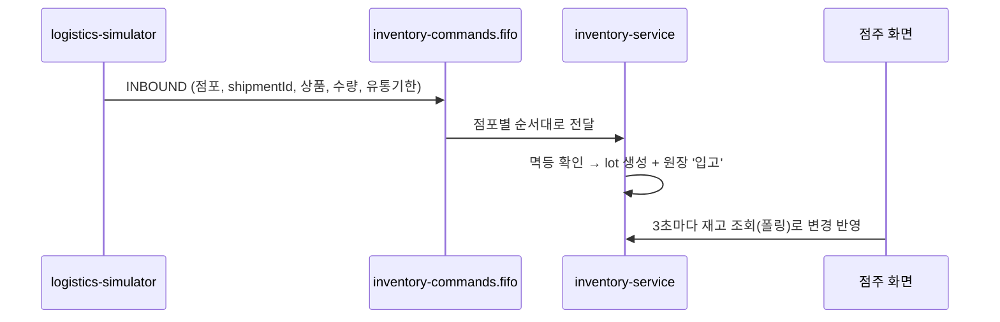

# logistics-simulator

> **가상의 물류센터**. 실제 물류 시스템 대신 점포별 입고 정보(INBOUND 쪽지)를 만들어 재고 큐에 넣는다. 시연할 때 버튼이나 API 한 번으로 점포 3곳에 상품을 들여보낸다.

| 항목 | 내용 |
| --- | --- |
| 담당 | 김진아 |
| 관련 기능 ID | E-13 logistics-simulator |
| 기술 | Java 21, Spring Boot 4.0.x, Spring Cloud AWS 4.x (SQS) |
| 관측성 | Actuator·Micrometer → Prometheus (앱 포트의 `/actuator/prometheus`, 관리 포트를 따로 두지 않는다. 모든 서비스가 8080) · Micrometer Tracing → Zipkin · JSON 로그(traceId 포함) → Alloy → Loki ([gitops/platform/observability](https://github.com/sesac-freshlink/gitops/tree/main/platform/observability)) |
| DB | 없음 (더미 입고 데이터를 생성) |
| 배포 | GitHub Actions → ECR `freshlink/logistics-simulator` → ArgoCD → EKS (파드 1개, 시연 때 사용) |

---

## 1. FreshLink는 무엇인가

편의점 점주와 고객이 **같은 재고 데이터**를 보는 서비스다. 전체 소개는 [Organization README](https://github.com/sesac-freshlink)를 참고한다.

## 2. 아키텍처에서의 위치



> 예: 새벽 5시, 시뮬레이터가 역삼점에 컵라면 20개(유통기한 10월 20일)와 우유 10개(10월 9일) 입고 쪽지를 보낸다. 점주가 출근하면 재고 화면에 유통기한별로 들어와 있다.

## 3. INBOUND 쪽지 형식

큐: `<QUEUE_PREFIX>inventory-commands.fifo` (클러스터는 `dev-inventory-commands.fifo`) · 메시지 그룹 = `storeId` · 중복 제거 키 = `messageId`

```json
{
  "type": "INBOUND",
  "messageId": "6a0f…-uuid",
  "createdAt": "2026-10-17T05:00:12+09:00",
  "storeId": 1,
  "shipmentId": "SHP-20261017-050012345-S1",
  "items": [
    { "productCode": "P016", "quantity": 20, "expiryDate": "2026-10-20T23:59:59+09:00" },
    { "productCode": "P012", "quantity": 10, "expiryDate": "2026-10-09T23:59:59+09:00" }
  ]
}
```

- 쪽지 DTO는 [common](https://github.com/sesac-freshlink/common)의 `InboundMessage`를 그대로 쓴다(`com.freshlink:common:0.1.1`).
- 점포마다 쪽지 하나. `shipmentId`는 `SHP-<날짜>-<시각 밀리초>-S<점포ID>`라 누를 때마다 새로 생긴다. 같은 쪽지가 두 번 가도 inventory-service가 messageId(멱등)로 거른다.
- DB가 없어서 Outbox를 쓰지 않고 SQS로 바로 보낸다.

### 시연 프리셋 (`application.yml`의 `simulator.preset`)

점포 ID·상품 코드는 dev 더미 데이터(infra `scripts/seed/dev-*.sql`)와 같다.

| 점포 | 상품 | 수량 | 유통기한 |
| --- | --- | --- | --- |
| 1, 2, 3 | P016 순한 컵라면 110g | 20 | 2026-10-20 |
| 1, 2, 3 | P012 흰 우유 500ml | 10 | 2026-10-09 (지난 재고 시연) |

## 4. 폴더 구조

```
logistics-simulator/
├── src/main/java/com/freshlink/simulator/
│   ├── config/      # SimulatorProperties(큐 이름, 프리셋), Clock
│   ├── shipment/    # 입고 실행 API, 요청 → 점포별 InboundMessage
│   └── messaging/   # InboundPublisher (SqsTemplate, 그룹 = storeId, 중복 제거 = messageId)
├── src/main/resources/application.yml
├── src/main/resources/static/index.html   # 입고 버튼 화면
└── src/test/java/com/freshlink/simulator/
```

## 5. dev 환경에서 실행하기

### API

| 메서드 | 경로 | 설명 |
| --- | --- | --- |
| `POST` | `/simulator/shipments` | 입고 실행. 본문 없이 보내면 프리셋. 본문 `{"storeIds":[1],"items":[{"productCode":"P016","quantity":5,"expiryDate":"2026-10-25"}]}`로 바꿀 수 있다(빈 필드는 프리셋 값). 응답 202 `{queue, shipments:[{storeId, shipmentId, messageId, itemCount}]}` |
| `GET` | `/simulator/preset` | 보낼 큐와 프리셋 확인 |
| `GET` | `/` | 입고 버튼 화면 |

gateway에 라우트가 없어서 밖에서는 닿지 않는다. 시연 때는 port-forward로 연다.

### dev 클러스터에서 버튼 누르기 (PowerShell)

1. `aws login`(또는 MFA 로그인)으로 AWS에 들어가고 `aws eks update-kubeconfig --name freshlink-dev-eks --region ap-northeast-2`를 한 번 실행한다.
2. `kubectl -n freshlink port-forward svc/logistics-simulator 8085:8080`을 실행하고 창을 열어 둔다.
3. 브라우저에서 `http://localhost:8085`를 열고 **입고 보내기**를 누른다. 결과에 점포 3곳의 shipmentId가 나오면 성공이다.
4. 버튼 대신 `Invoke-RestMethod -Method Post http://localhost:8085/simulator/shipments`로 보내도 된다.

### PC에서 띄우기 (개인 큐로)

개발할 때도 AWS dev 환경을 그대로 쓴다. AWS 로그인과 개인 큐는 [개발 환경 접속 가이드](https://github.com/sesac-freshlink/.github/blob/main/docs/개발환경-접속.md)를 따른다. common을 받으려면 환경 변수 `GITHUB_ACTOR`, `GITHUB_TOKEN`(`read:packages`)이 있어야 한다.

```powershell
$env:SPRING_PROFILES_ACTIVE = "dev"
$env:QUEUE_PREFIX = "dev-taewoo-"   # 개인 큐 dev-taewoo-inventory-commands.fifo로 보낸다
.\gradlew.bat bootRun
```

## 6. 브랜치와 기여

- `main`(배포) ← `dev`(통합, 기본 브랜치) ← `feat/<기능ID>-<설명>` (예: `feat/E-13-inbound-publisher`)
- 커밋·PR 제목: `feat(E-13): 입고 쪽지 발행`

자세한 규칙은 [.github 레포](https://github.com/sesac-freshlink/.github)를 참고한다.
