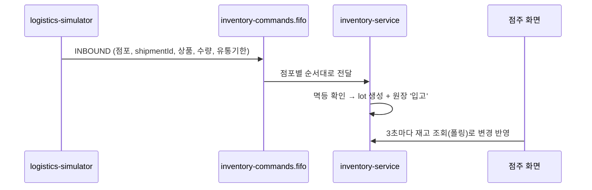
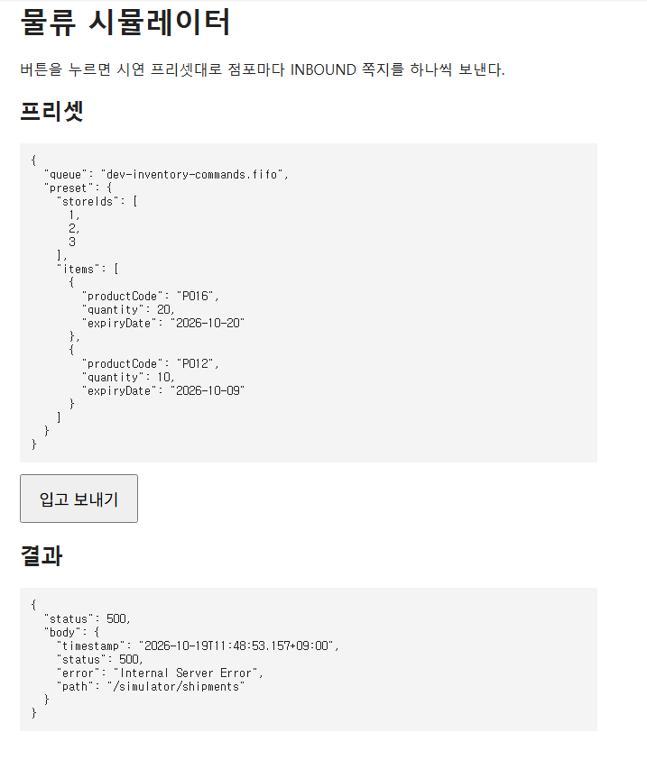

# logistics-simulator

> **가상의 물류센터**. 실제 물류 시스템 대신 점포별 입고 정보(INBOUND 쪽지)를 만들어 재고 큐에 넣는다. 시연할 때 버튼이나 API 한 번으로 점포 3곳에 상품을 들여보낸다.

| 항목 | 내용 |
| --- | --- |
| 담당 | 김진아 |
| 관련 기능 ID | E-13 logistics-simulator |
| 기술 | Java 21, Spring Boot 4.0.x, Spring Cloud AWS 4.x (SQS) |
| 관측성 | Actuator·Micrometer → Prometheus (앱 포트의 `/actuator/prometheus`, 관리 포트를 따로 두지 않는다. 모든 서비스가 8080) · Micrometer Tracing → Zipkin · JSON 로그(traceId 포함) → Alloy → Loki ([gitops/platform/observability](https://github.com/sesac-freshlink/gitops/tree/main/platform/observability)) |
| DB | 없음 (더미 입고 데이터를 생성) |
| 배포 | GitHub Actions → ECR `freshlink/logistics-simulator` → ArgoCD → EKS (파드 1개, 시연 때 사용) |

---

## 1. FreshLink는 무엇인가

편의점 점주와 고객이 **같은 재고 데이터**를 보는 서비스다. 전체 소개는 [Organization README](https://github.com/sesac-freshlink)를 참고한다.

## 2. 아키텍처에서의 위치



> 예: 새벽 5시, 시뮬레이터가 역삼점에 컵라면 20개(유통기한 10월 20일)와 우유 10개(10월 9일) 입고 쪽지를 보낸다. 점주가 출근하면 재고 화면에 유통기한별로 들어와 있다.

## 3. INBOUND 쪽지 형식

큐: `<QUEUE_PREFIX>inventory-commands.fifo` (클러스터는 `dev-inventory-commands.fifo`) · 메시지 그룹 = `storeId` · 중복 제거 키 = `messageId`

```json
{
  "type": "INBOUND",
  "messageId": "6a0f…-uuid",
  "createdAt": "2026-10-17T05:00:12+09:00",
  "storeId": 1,
  "shipmentId": "SHP-20261017-050012345-S1",
  "items": [
    { "productCode": "P016", "quantity": 20, "expiryDate": "2026-10-20T23:59:59+09:00" },
    { "productCode": "P012", "quantity": 10, "expiryDate": "2026-10-09T23:59:59+09:00" }
  ]
}
```

- 쪽지 DTO는 [common](https://github.com/sesac-freshlink/common)의 `InboundMessage`를 그대로 쓴다(`com.freshlink:common:0.1.1`).
- 점포마다 쪽지 하나. `shipmentId`는 `SHP-<날짜>-<시각 밀리초>-S<점포ID>`라 누를 때마다 새로 생긴다. 같은 쪽지가 두 번 가도 inventory-service가 messageId(멱등)로 거른다.
- DB가 없어서 Outbox를 쓰지 않고 SQS로 바로 보낸다.

### 시연 프리셋 (`application.yml`의 `simulator.preset`)

점포 ID·상품 코드는 dev 더미 데이터(infra `scripts/seed/dev-*.sql`)와 같다.

| 점포 | 상품 | 수량 | 유통기한 |
| --- | --- | --- | --- |
| 1, 2, 3 | P016 순한 컵라면 110g | 20 | 2026-10-20 |
| 1, 2, 3 | P012 흰 우유 500ml | 10 | 2026-10-09 (지난 재고 시연) |

## 4. 폴더 구조

```
logistics-simulator/
├── src/main/java/com/freshlink/simulator/
│   ├── config/      # SimulatorProperties(큐 이름, 프리셋), Clock
│   ├── shipment/    # 입고 실행 API, 요청 → 점포별 InboundMessage
│   └── messaging/   # InboundPublisher (SqsTemplate, 그룹 = storeId, 중복 제거 = messageId)
├── src/main/resources/application.yml
├── src/main/resources/static/index.html   # 입고 버튼 화면
└── src/test/java/com/freshlink/simulator/
```

## 5. dev 환경에서 실행하기

### API

| 메서드 | 경로 | 설명 |
| --- | --- | --- |
| `POST` | `/simulator/shipments` | 입고 실행. 본문 없이 보내면 프리셋. 본문 `{"storeIds":[1],"items":[{"productCode":"P016","quantity":5,"expiryDate":"2026-10-25"}]}`로 바꿀 수 있다(빈 필드는 프리셋 값). 응답 202 `{queue, shipments:[{storeId, shipmentId, messageId, itemCount}]}` |
| `GET` | `/simulator/preset` | 보낼 큐와 프리셋 확인 |
| `GET` | `/` | 입고 버튼 화면 |

gateway에 라우트가 없어서 밖에서는 닿지 않는다. 시연 때는 port-forward로 연다.

### dev 클러스터에서 버튼 누르기 (PowerShell)

1. `aws login`(또는 MFA 로그인)으로 AWS에 들어가고 `aws eks update-kubeconfig --name freshlink-dev-eks --region ap-northeast-2`를 한 번 실행한다.
2. `kubectl -n freshlink port-forward svc/logistics-simulator 8085:8080`을 실행하고 창을 열어 둔다.
3. 브라우저에서 `http://localhost:8085`를 열고 **입고 보내기**를 누른다. 결과에 점포 3곳의 shipmentId가 나오면 성공이다.
4. 버튼 대신 `Invoke-RestMethod -Method Post http://localhost:8085/simulator/shipments`로 보내도 된다.

### 입고 버튼 화면



위쪽 **프리셋**에 보낼 큐와 점포·상품이 나오고, **입고 보내기**를 누르면 아래 **결과**에 응답이 그대로 찍힌다. 정상이면 `status: 202`와 점포 3곳의 shipmentId가 나온다. (이 캡처의 500은 sts 의존성을 넣기 전([#7](https://github.com/sesac-freshlink/logistics-simulator/pull/7)) 파드가 AWS 자격을 못 받아 난 오류다.)

### PC에서 띄우기 (개인 큐로)

개발할 때도 AWS dev 환경을 그대로 쓴다. AWS 로그인과 개인 큐는 [개발 환경 접속 가이드](https://github.com/sesac-freshlink/.github/blob/main/docs/팀원-가이드/0-개발환경-접속.md)를 따른다. common을 받으려면 환경 변수 `GITHUB_ACTOR`, `GITHUB_TOKEN`(`read:packages`)이 있어야 한다.

```powershell
$env:SPRING_PROFILES_ACTIVE = "dev"
$env:QUEUE_PREFIX = "dev-taewoo-"   # 개인 큐 dev-taewoo-inventory-commands.fifo로 보낸다
.\gradlew.bat bootRun
```

## 5-1. 매일 데모 시나리오 (3차 할 일 1-2)

prod를 켜 두면 사람이 손대지 않아도 하루 동안 입고 → 주문 → 결제 → 픽업 준비 → 픽업이 쌓인다. 대형 부하 테스트가 아니다(30곳 합쳐 하루 100–200건). 코드는 `schedule/` 패키지.

| 시각(KST) | 하는 일 |
| --- | --- |
| `inbound-cron`(prod 매일 09:20) | ① `SIMULATOR_DISPOSE_EXPIRED=true`면 점포마다 점주 대신 경과 lot 한 번에 폐기(inventory `POST /owner/inventory/disposals/expired`, 요청자 `logistics-simulator`). ② 점포마다 오늘 입고. `shipmentId = SHP-<날짜>-AM-S<점포>`라 같은 날 다시 보내도 inventory가 한 번만 받는다 |
| 켜질 때 | 오늘 `inbound-cron` 시각이 이미 지났으면 ②만(폐기 안 함). 아직 전이면 cron을 기다린다(cron 전에 넣으면 cron 폐기가 어제 마감 시연 lot까지 지운다) |
| 10:00–20:00 (점심·저녁 두 배) | 가상 고객이 단골 점포에서 판매 중 상품 1개(선착순 제외)·1–3개 주문 → `PAYMENT_WAITING`이 되면 order `/ops/orders/{id}/simulated-payment`(토스 없음). 약 5%는 결제하지 않고 둔다(10분 뒤 `EXPIRED`). `SIMULATOR_CLEARANCE_RATE`(기본 30%)는 마감세일 수량이 있는 상품을 마감세일(`clearanceQuantity`)로 산다(06–23시, 없으면 기본 주문) |
| 결제 5–20분 뒤 / 준비 10–40분 뒤 | 점주 대신 픽업 준비 완료 / 픽업 확인. 10%는 픽업하지 않아 기한 경과가 생긴다 |

- 입고량(11/10): 고객 상품 목록의 `availableQuantity`(기본 주문으로 살 수 있는 수량)를 보고 목표만큼만 채운다. 도시락·김밥·샌드위치·샐러드는 그날 40%만 1–3개(유통기한 1–2일), 빵·유제품·디저트·과일·신선식품 2–4개, 오래가는 상품 4–8개. 시연용으로 1–2개는 오늘 마감 2–4개(임박 알림·마감세일), 1개는 어제 마감 1–3개(점주 경과 탭·폐기). 예전(상품 20–30개 × 5–30개)은 판매보다 훨씬 많아 경과 lot이 쌓였다.
- 신상품(11/10): `SIMULATOR_LAUNCH_FROM`·`TO`를 정하면 점포마다 P031–P036 중 3개(`SIMULATOR_LAUNCH_PER_STORE`)를 그 기간 안 정해진 날 처음 입고(4–6개)하고 그 뒤로 계속 채운다. 고객 화면 신상품 배지는 첫 입고 뒤 7일이라 시연일 전 7일 안으로 잡는다. 상품 행(infra `scripts/seed/<env>-inventory.sql`)이 없는 환경에서 켜면 그 점포 입고가 통째로 실패한다.
- 같은 날짜면 같은 입고·같은 주문 계획이 나온다(난수 씨앗 = 점포·날짜, 입고는 같은 재고일 때). 진행 중인 주문은 메모리에만 있어 파드가 다시 뜨면 그날 남은 픽업 처리만 빠지고, 이미 지난 시각 주문은 건너뛴다.
- order·inventory·member는 gateway를 거치지 않고 클러스터 안 Service 주소로 부르며 `X-User-*` 헤더를 직접 넣는다. 실패하면 로그만 남기고 다음으로 넘어간다.
- 상태: `GET /simulator/schedule` (오늘 입고한 점포, 계획·주문·결제 수, 다음 실행 시각).

| 환경 변수 | 뜻 | dev | prod |
| --- | --- | --- | --- |
| `SIMULATOR_SCHEDULE_ENABLED` | 스케줄 전체 | `true` | `true` |
| `SIMULATOR_INBOUND_CRON` | 아침 입고 (Spring cron) | `0 20 9 * * MON-FRI` | `0 20 9 * * *` |
| `SIMULATOR_ORDERS_ENABLED` | 주문 시나리오 | `false` (필요할 때만) | `true` |
| `SIMULATOR_ORDERS_PER_STORE_MIN`·`MAX` | 점포당 하루 주문 | 2·3 | 3·6 |
| `SIMULATOR_STORES` | 대상 점포 (비면 고객 단골 점포 전부) | `1,2,3` | 비움(1–30) |
| `SIMULATOR_CUSTOMERS` | 가상 고객 `sub:점포,점포;…` | External Secret `freshlink-dev/simulator/customers` | `freshlink-prod/simulator/customers` |
| `SIMULATOR_CANCEL_RATE` | 결제 뒤 고객 취소 비율 | 0 | 0 (켜면 SIM- 환불) |
| `SIMULATOR_CLEARANCE_RATE` | 마감세일로 사는 주문 비율 | 0.3 (기본) | 0.3 (기본) |
| `SIMULATOR_DISPOSE_EXPIRED` | 아침 cron 때 경과 lot 폐기 | `false` (팀원 폐기 시험) | `true` |
| `SIMULATOR_LAUNCH_FROM`·`TO`·`PER_STORE` | 신상품 첫 입고 기간·점포당 수 | 비움(끔) | `2026-11-14`·`2026-11-19`·3 (시연 11/20) |

고객 비밀은 infra `scripts/seed-cognito.ps1`이 만든다(비밀번호 없음). order에는 `SIMULATED_PAYMENT_ENABLED=true`가 있어야 결제 완료 API가 열린다.

## 6. 브랜치와 기여

- `main`(배포) ← `dev`(통합, 기본 브랜치) ← `feat/<기능ID>-<설명>` (예: `feat/E-13-inbound-publisher`)
- 커밋·PR 제목: `feat(E-13): 입고 쪽지 발행`

자세한 규칙은 [.github 레포](https://github.com/sesac-freshlink/.github)를 참고한다.
